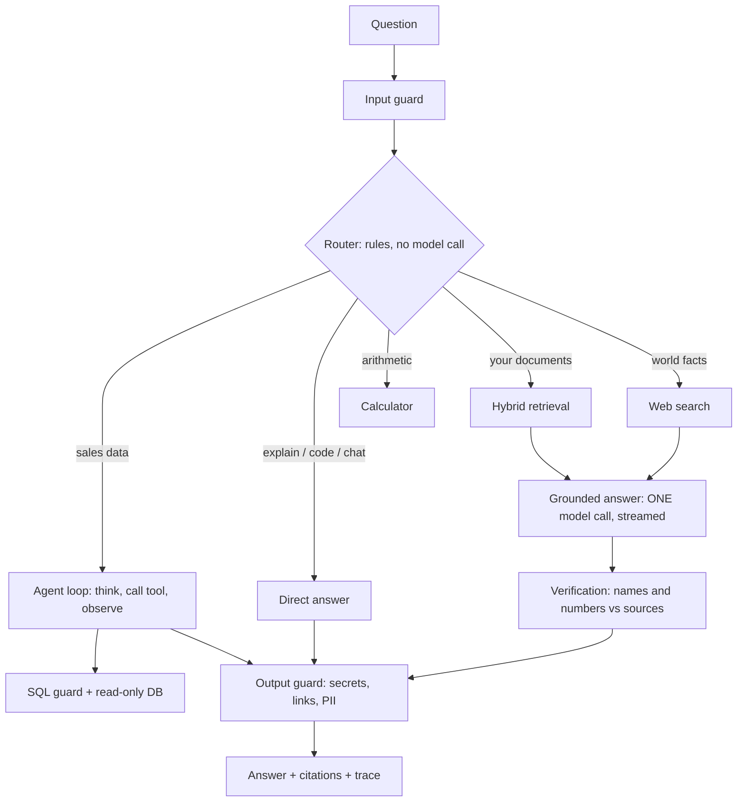

# AgentLens

[](https://github.com/hackercloudy/AgentLens/actions)    

**An open-source workbench for building a question-answering agent on local LLMs, then *inspecting*, *testing* and *attacking* it.**

Most chatbot demos stop at "it answers". AgentLens is built around three harder questions:

1. **How did it get that answer?** Every thought, tool call, source, token and millisecond is visible, live.
2. **How good is it, really?** A repeatable evaluation suite scores it, and an ablation sweep shows what each design choice is worth.
3. **Can it be tricked?** A red-team suite runs prompt-injection, data-leak and tool-abuse attacks with the defences off and on.

It runs fully on your own machine with [Ollama](https://ollama.com) (Qwen, Llama, Gemma, Mistral...), and also works with Groq or any OpenAI-compatible server. No API key is required.

> The demo documents and sales database are **synthetic**. Drug names, hospitals and figures are fictional and nothing here is medical advice.

## What it can do

| You ask | What AgentLens does |
|---|---|
| A question about **your documents** (PDF/TXT/MD) | Hybrid search (embeddings + BM25), answers from the passages with `[n]` citations |
| A **data question** ("which region had the biggest drop last quarter?") | The model writes read-only SQL for a sales database and explains the result |
| A **factual question about the world** ("who...", "latest...") | Searches the web first, then answers only from the results, then checks names/numbers against them |
| An **explanation, code or writing request** | Direct answer, streamed token by token |
| **Arithmetic** | Safe calculator, no model call |
| Something **it can't know** | Says so, instead of guessing |

## Quick start

```bash
git clone https://github.com/hackercloudy/AgentLens.git
cd AgentLens
python -m venv .venv
.venv\Scripts\activate            # macOS/Linux: source .venv/bin/activate
pip install -r requirements.txt
python -m uvicorn app.main:app --reload --port 8000
```

Open <http://localhost:8000>. It works immediately with a built-in **offline simulator** (a rule-based stand-in used for demos, tests and CI; it only understands the demo questions).

### Use a real model (recommended)

```bash
# install Ollama from https://ollama.com, then:
ollama pull qwen2.5:3b          # ~2 GB, fast. Use qwen2.5:7b (~4.7 GB) for better factual answers
ollama pull nomic-embed-text    # optional: neural embeddings (choose it in the Knowledge tab)
```

Reload the page: the model is detected and selected automatically. Hosted open models: set `GROQ_API_KEY`. Any OpenAI-compatible server: set `OPENAI_BASE_URL` / `OPENAI_API_KEY` (see `.env.example`).

## The interface

| Tab | Purpose |
|---|---|
| **Chat** | Streaming answers with a live **trace** (thought, tool, observation), **sources** (documents and web links), token **budget** vs the context window, and all settings |
| **Compare** | One question under two setups (documents on/off, guardrails on/off, prompt styles, temperature) side by side |
| **Knowledge** | Upload files, tune chunk size/overlap/embeddings, test retrieval without the model, 2D **embedding map**, browse the SQL data |
| **Playground** | Live tokenizer (see why Hindi costs more tokens), temperature/top-p sampling lab, direct model sampling |
| **Evals** | 29 questions with machine-checked answers (gold SQL, expected facts, citations, abstention) and an **ablation sweep** |
| **Red team** | 8 attacks + a control question, run with guardrails off and on; shows which layer stopped each |
| **Learn** | Short explainers: tokens, embeddings, RAG vs fine-tuning, sampling, transformers, evals, safety, Ollama setup |

Three themes (**Emerald + Charcoal** default, **Aurora** light, **Midnight** dark). Shortcuts: `Ctrl+K` command palette, `/` focus the chat box.

## How it works



**Why a router?** Small local models are unreliable at choosing tools, and every extra model call costs 10 to 30 seconds on a laptop CPU. Deterministic routing removes the tool-choice errors and cuts most questions to **one** model call. Only database questions use the slower tool-calling loop, because the model has to write SQL.

**Retrieval.** Documents are split into paragraph-aware chunks (default 600 characters, 80 overlap). Search combines dense embeddings with BM25 using reciprocal-rank fusion. A confidence threshold lets the agent say "I don't know" instead of answering from weak matches. Embeddings are either an offline hashing embedder (no downloads) or neural embeddings via Ollama.

**Verification.** After an answer is written from sources, every capitalised name and number is checked against those sources. Near-miss spellings are repaired ("Akay" to "Akaay"); details that appear nowhere in the sources are flagged as unverified. This is mechanical (difflib and regex), so it adds no model call.

**Guardrails** (all switchable, so the Red team tab can show before/after):

| Layer | Stops |
|---|---|
| Input guard | "Ignore your instructions...", role-play jailbreaks, exfiltration links in the prompt |
| Context sanitiser | Hidden instructions inside retrieved documents or web pages (indirect injection) |
| SQL guard + read-only database | Writes and multi-statement queries. The DB is opened read-only as a second lock |
| Output guard | Secret leakage, external links/images, personal data (emails, phones, IDs, cards) |
| Log masking | Personal data never reaches the query log |

## Evaluation

`app/evalset.py` holds 29 cases in four groups: document Q&A, data questions (checked against a **gold SQL** query run on the live database, so expectations cannot drift), questions needing both, and questions that must be refused. Each case checks the right fact, a citation, the right tool and abstention where relevant. The **ablation sweep** reruns the suite with one setting changed (documents off, small/large chunks, keyword-only, embeddings-only, top-1) so you can see what each choice is worth. Evals and Red team always run in strict mode (General knowledge and Web search off) so results are reproducible.

## Project layout

```
app/agent.py       agent loop, router, routed pipeline, tracing, token accounting
app/grounding.py   answer verification and citation tidying
app/prompts.py     system prompts and prompt styles (zero-shot, few-shot, step-by-step)
app/store.py       vector store, BM25, hybrid search, 2D projection
app/embeddings.py  offline hashing embedder, Ollama embeddings
app/chunking.py    paragraph/sentence-aware chunking
app/tools.py       document search, web search, read-only SQL, calculator
app/safety.py      injection detection, sanitiser, SQL guard, PII masking, output guard
app/llm.py         Ollama (with streaming), Groq, OpenAI-compatible providers
app/simulator.py   offline rule-based stand-in (also a toy bigram LM for the Playground)
app/evalset.py     the 29 evaluation cases        app/evals.py   runner and history
app/redteam.py     the attack suite               app/main.py    API, SSE streaming, static UI
app/web/           main UI: plain HTML/CSS/JS, no build step
streamlit_app.py   Streamlit edition of the UI (same backend)
tests/             36 pytest tests (also the CI quality gate)
```

## Tests

```bash
pip install -r requirements-dev.txt
pytest -q
```

CI (`.github/workflows/ci.yml`) runs the tests and fails the build if offline eval accuracy drops below 90%.

## Honest limitations

- The **offline simulator** is rule-based and deliberately gullible so attacks are visible. Its eval and red-team numbers are **not** model-quality numbers. Run Evals and Red team against a real model and report those.
- Small local models (3B to 7B) make mistakes. Verification catches misspellings and unsupported names, not wrong claims that appear in a bad source. Check the Sources tab for anything important.
- Web search uses the `ddgs` package, which scrapes search engines and can be rate-limited. Wikipedia is the fallback.
- Guardrails are heuristic layers plus structural limits (a read-only database). They reduce risk; they do not make prompt injection impossible.
- Token counts use an approximate tokenizer unless the provider reports exact counts.
- Demo data is synthetic.

## Streamlit edition

`streamlit_app.py` runs the same backend behind a simpler Streamlit screen (Chat with trace and sources, Evals with the ablation sweep, Red team, Knowledge). It is the easiest way to get a free public link:

```bash
streamlit run streamlit_app.py
```

## Deploying

See **[DEPLOY.md](DEPLOY.md)**: a public tunnel for demos, Render + Groq for a permanent link, and the optional protections (`AGENTLENS_READONLY`, `AGENTLENS_RATE_LIMIT`, `AGENTLENS_PASSWORD`).

## Docker

```bash
docker compose up --build        # uses Ollama running on the host (host.docker.internal:11434)
```

## License

MIT, see `LICENSE`.
